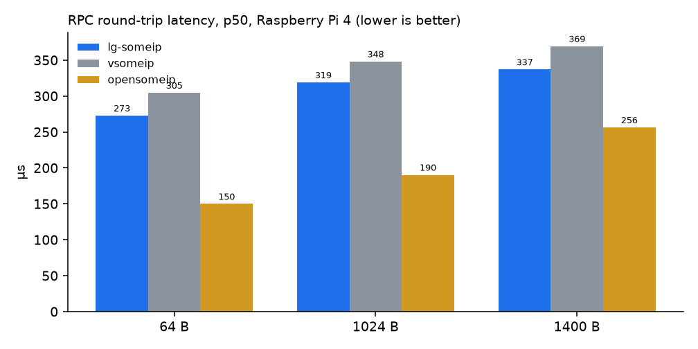
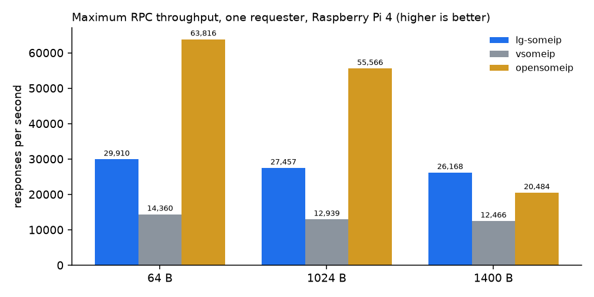
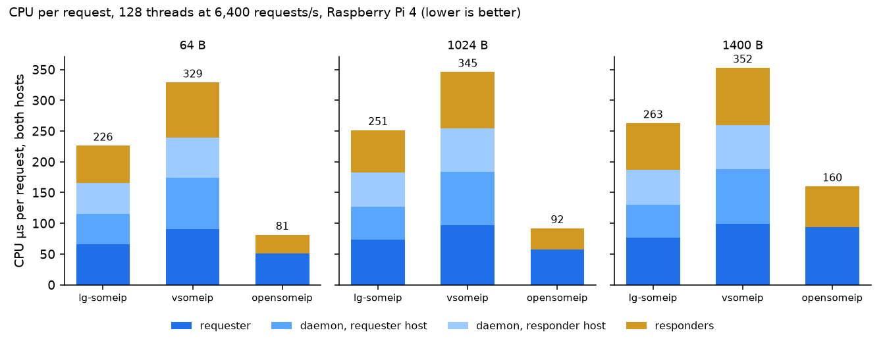
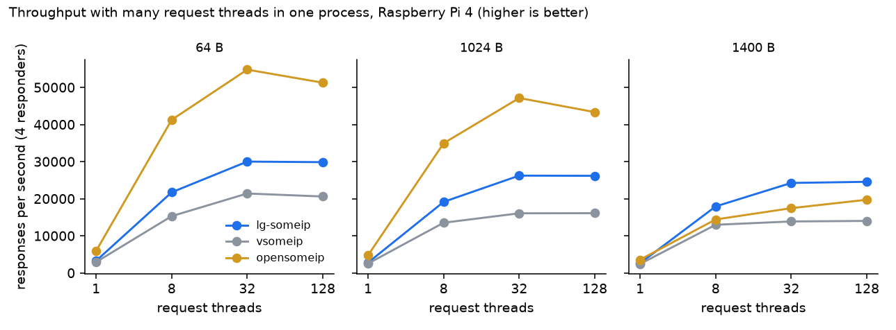
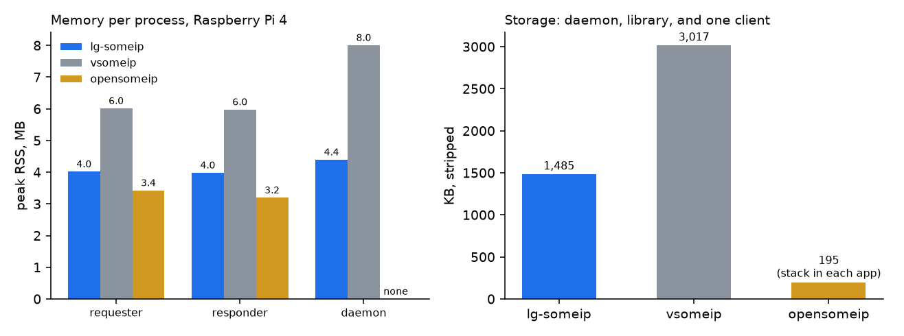

# lg-someip for S-CORE: Comparison with vsomeip and opensomeip

_Status: draft · Compared versions: lg-someip `c154a40`, vsomeip 3.7.6 (COVESA), opensomeip v0.2.0 · Date: 2026-10-14_

## 1. Executive summary

lg-someip is a C++ SOME/IP and SOME/IP-SD stack with a routing daemon. It has the
same architecture as vsomeip and a vsomeip-compatible API. This document explains
what lg-someip offers S-CORE and how it compares with the other stacks. It
compares lg-someip mainly with vsomeip, the established stack with the same
architecture, and also describes the gaps that opensomeip, which has no daemon
and is proposed as the Eclipse LIBERSOM project, still has for ECUs with several
applications.

| # | Merit | Evidence (details in the section listed) |
|---|---|---|
| 1 | **Proven in series production** | Deployed in mass production at a German premium OEM (§3). |
| 2 | **Faster and lighter** | Against vsomeip on a Raspberry Pi 4 (Cortex-A72, ECU-class CPU): 2.1× maximum throughput, 25–31% less CPU per request, 8–10% lower latency (p50), 33–45% less RAM, and 51% less storage. The same ranking holds on a Raspberry Pi 5 (§4). |
| 3 | **No Boost, C++14 only** | lg-someip needs only the C++ runtime and header-only RapidJSON. vsomeip needs Boost ≥ 1.75 and a C++20 compiler (§6). |
| 4 | **TLS / DTLS built in** | TLS 1.2 over TCP and DTLS 1.2 over UDP, enabled per service. vsomeip 3.7.6 has no transport encryption (§7). |
| 5 | **Drop-in for vsomeip users** | The bundled vsomeip API lets existing applications switch without code changes (§8). |
| 6 | **Apache-2.0 and a small code base** | Apache-2.0 licence and about 40% of vsomeip's code size (excluding Boost), which makes review and qualification cheaper (§8, §9). |
| 7 | **Ready for multi-application ECUs today** | opensomeip v0.2.0 is faster on small messages because it has no daemon. As a pre-1.0 project it still lacks the host-wide coordination that an ECU with several applications needs; for example, different services cannot share a port, which is common in OEM projects. lg-someip is faster than opensomeip at 1400 B (§4, §5). |

## 2. Compared stacks

| | lg-someip | vsomeip | opensomeip |
|---|---|---|---|
| What it is | SOME/IP stack developed by LG Electronics since 2017 | The established open-source SOME/IP stack, originally developed by BMW and maintained in the COVESA (formerly GENIVI) project. It is the SOME/IP stack behind the CommonAPI C++ SOME/IP binding. | A newer open-source SOME/IP stack, started in 2025 (`github.com/vtz/opensomeip`). It is proposed to the Eclipse Foundation as **Eclipse LIBERSOM** under Eclipse Automotive; the proposal was in community review as of October 2026. |
| Version compared | `c154a40` | 3.7.6 with Boost 1.83 | v0.2.0 |
| Architecture | Routing daemon (`someip-daemon`) plus a library in each application | Routing daemon (`routingmanagerd`) plus a library in each application | Library only, linked into each application; no daemon |
| Language and mandatory dependencies | C++14; RapidJSON (header-only) | C++20; Boost ≥ 1.75 | C++17; none |
| Licence | Apache-2.0 (vsomeip API layer and E2E library: MPL-2.0) | MPL-2.0 | Apache-2.0 |
| Maturity | Series production at a German premium OEM | Mature, widely used open-source implementation | Pre-1.0 release; its documentation states that safety alignment is ongoing and that it is not certified |

- **vsomeip is the main reference.** lg-someip and vsomeip have the same
  design: one routing daemon per host owns Service Discovery (SD) and the
  network ports, and applications connect to it over local IPC. A request takes
  the same four hops in both stacks
  (application → daemon → network → daemon → application), so the measured
  differences come from the implementations, not from the architecture.
- **opensomeip is included as the daemon-less alternative.** It has no daemon: each
  application owns its own sockets, including the SD socket, and a request
  crosses two processes instead of four. This makes it faster on small
  messages, but it leaves out the host-wide coordination that an ECU with
  several applications needs (§5).
- **Build and sources.** All stacks were built as `Release`. The performance
  results come from the lg-someip performance measurement suite
  (`performance-measurement`). The code statements
  come from the source trees of the projects. The opensomeip summary in §5 comes
  from our analysis in `opensomeip-v0.2.0-findings.md`.

## 3. Production maturity

lg-someip is not a new project. LG Electronics has developed it since 2017, and
it has been used in **series production at a German premium OEM**. Details of
the program are confidential.

**Why it matters for S-CORE.** A stack that has passed an OEM's integration,
validation, and field operation has already met real-world requirements:

- interoperability with other suppliers' SOME/IP stacks on the vehicle network,
- long-term stability,
- start-up timing, and
- defect handling under an automotive quality process.

A component with this history lowers S-CORE's adoption risk.

## 4. Performance

### 4.1 Test platforms

- **Main platform: Raspberry Pi 4 Model B.** Its quad-core Cortex-A72 is close
  to the CPUs of many current automotive SoCs (for example NXP i.MX 8QuadMax and
  TI Jacinto TDA4VM). On a CPU of this class the cost of the stack itself is a
  larger share of each request, which is what limits a real ECU. All main
  results, tables, and figures in this section come from the Pi 4.
- **Reference platform: Raspberry Pi 5.** The same tests ran on Pi 5 boards
  (Cortex-A76, a newer and faster CPU) to check that the result does not depend
  on one board (§4.4).

### 4.2 Test setup

- **Hardware.** Two boards of the same model on a direct 1 Gb/s Ethernet link,
  with CPU governor `performance`, `net.core.rmem_max` 4 MB, and PTP on both.
  The daemons ran on CPU 1 and the applications on CPUs 2–3. The responders ran
  on host A and the requesters on host B. The Pi 4 boards ran kernel 6.12 and
  the Pi 5 boards ran kernel 6.18, so compare the stacks on one board, not
  numbers across boards.
- **Workload.** All three stacks ran the same measurement kit: the same payload
  layout, pacing, percentile calculation, and CPU accounting. They also used the
  same service, method, instance, and payload sizes on the wire. Traffic was
  RPC over UDP with 64, 1024, and 1400 B payloads (1400 B is the largest payload
  that fits one UDP datagram without SOME/IP-TP).
- **opensomeip runs without Service Discovery.** The benchmark gives the
  opensomeip applications the provider's address and port directly and does not
  use opensomeip's SD (see §5 for its SD limitations). Its numbers therefore leave
  out discovery and are its best case.
- **Repetitions.** The latency, throughput, and memory figures are medians of 5
  repetitions, and the many-thread and event figures are medians of 3. Each
  repetition changes the order in which the stacks run.

### 4.3 Results on Raspberry Pi 4 (main platform)

**Latency.** Round trip of one request with one outstanding (closed loop), from
just before the send call to the start of the response callback.

| Payload | lg-someip p50 / p99 | vsomeip p50 / p99 | opensomeip p50 / p99 | lg-someip lower than vsomeip (p50 / p99) |
|---|---|---|---|---|
| 64 B | 272.9 / 286.9 µs | 304.6 / 332.7 µs | 149.9 / 159.4 µs | **10.4% / 13.8%** |
| 1024 B | 319.0 / 335.4 µs | 348.2 / 378.2 µs | 190.3 / 200.4 µs | **8.4% / 11.3%** |
| 1400 B | 337.1 / 355.4 µs | 369.5 / 404.9 µs | 256.3 / 270.0 µs | **8.8% / 12.2%** |

- **lg-someip against vsomeip:** 8.4–10.4% lower at p50 and 11.3–13.8% lower
  at p99. No request was lost. lg-someip's p99 is within 18 µs of its p50 at
  every payload size, so the tail is light. At a fixed load of 1,000 requests/s
  the result is the same: lg-someip is 8.5–10.6% lower at p50.
- **opensomeip** has the shortest round trip because it has no daemon: a
  request crosses two processes instead of four. Its lead over lg-someip
  shrinks from 123 µs at 64 B to 81 µs at 1400 B.



**Maximum throughput.** One requester sends as fast as it can with at most
1,000 requests in flight.

| Payload | lg-someip | vsomeip | opensomeip | lg-someip ÷ vsomeip |
|---|---|---|---|---|
| 64 B | 29,910 msg/s | 14,360 msg/s | 63,816 msg/s | **2.08×** |
| 1024 B | 27,457 msg/s | 12,939 msg/s | 55,566 msg/s | **2.12×** |
| 1400 B | **26,168 msg/s** | 12,466 msg/s | 20,484 msg/s | **2.10×** |

- lg-someip carries 2.08–2.12× the traffic of vsomeip at every payload size.
- opensomeip leads at 64 and 1024 B. At 1400 B its throughput drops to 20,484
  msg/s and lg-someip is 1.28× faster: opensomeip splits each 1400 B message
  into two packets with SOME/IP-TP, while lg-someip and vsomeip send one
  datagram.
- This is an overload test. lg-someip lost 0.8–2.3% of the requests and
  opensomeip 0.0–0.3%. vsomeip lost none because its client blocks when its
  queue is full (§10).



**CPU per request.** The sum over all processes on both hosts (requester,
both daemons, and responders). The load is one process with 128 request
threads calling 4 responders at a fixed 6,400 requests/s, so every stack
carries the same work.

| Payload | lg-someip | vsomeip | opensomeip | lg-someip lower than vsomeip |
|---|---|---|---|---|
| 64 B | 226 µs | 329 µs | 81 µs | **31%** |
| 1024 B | 251 µs | 345 µs | 92 µs | **27%** |
| 1400 B | 263 µs | 352 µs | 160 µs | **25%** |

- **lg-someip against vsomeip:** every process on the path is cheaper. For
  example, at 1024 B the daemon on the requester host costs 54 µs per request
  with lg-someip and 87 µs with vsomeip. With a single requester at 1,000
  requests/s, the requesting process uses 44 µs per request with lg-someip and
  74 µs with vsomeip (40% lower).
- **opensomeip** uses the least CPU because there are no daemons; in lg-someip
  the two daemons account for about 100 µs per request at 64 B. The gap narrows
  with the payload: from 1024 to 1400 B opensomeip's CPU per request rises by
  74% and lg-someip's by 5%.



**Many request threads in one process.** One process runs 1, 8, 32, or 128
threads. Each thread sends a request, waits for the response, and repeats,
calling 4 responders in turn.

| Payload, 128 threads | lg-someip | vsomeip | opensomeip | lg-someip ÷ vsomeip |
|---|---|---|---|---|
| 64 B | 29,852 msg/s, 0.00% lost | 20,593 msg/s, 0.00% lost | 51,257 msg/s, 0.16% lost | **1.45×** |
| 1024 B | 26,167 msg/s, 0.01% lost | 16,101 msg/s, 0.00% lost | 43,331 msg/s, 0.19% lost | **1.63×** |
| 1400 B | **24,551 msg/s, 0.00% lost** | 14,016 msg/s, 0.00% lost | 19,728 msg/s, 0.62% lost | **1.75×** |

- **lg-someip against vsomeip:** lg-someip has the higher throughput in all
  24 steps (1, 8, 32, and 128 threads; 1 or 4 responders; three payload sizes)
  and the lower p99 in 22 of them. The two exceptions are at 128 threads
  (1024 B with 4 responders and 1400 B with 1 responder), where lg-someip's p99
  is 2–12% higher while it serves 1.6–2.1× as many requests.
- **lg-someip scales steadily.** From 8 to 128 threads its CPU per request
  grows by only 12–19%. It lost at most 0.15% of requests in any step.
- **opensomeip** leads at 64 and 1024 B. At 1400 B lg-someip is 1.24× faster,
  and opensomeip lost up to 0.62% of its requests. opensomeip's RPC client
  stops responding after 65,535 calls, so the benchmark creates a new client
  every 50,000 calls (§5).



**Memory and storage.**

| | lg-someip | vsomeip | opensomeip | lg-someip lower than vsomeip |
|---|---|---|---|---|
| Peak RSS, requester | 4.0 MB | 6.0 MB | 3.4 MB | **33%** |
| Peak RSS, responder | 4.0 MB | 6.0 MB | 3.2 MB | **33%** |
| Peak RSS, daemon | 4.4 MB | 8.0 MB | no daemon | **45%** |
| Peak RSS, requester with 128 threads | 7.9 MB | 13.9 MB | 10.3 MB | **43%** |
| Storage of a consumer ECU (stripped daemon, library, and client) | 1,485 KB | 3,017 KB | 195 KB | **51%** |

- An ECU that runs one daemon and two applications saves about 8 MB of RAM
  with lg-someip instead of vsomeip. vsomeip's `libvsomeip3.so` alone is
  2,820 KB. The binaries were the same size on the Pi 4 and the Pi 5, so the
  storage figures apply to both.
- opensomeip is the smallest per process because it has no daemon. With 128
  request threads, however, it uses more memory than lg-someip (10.3 against
  7.9 MB). Its stack is linked into every application, so each application
  carries its own copy, its own sockets, and its own SD threads.



**Event distribution on the link.** One publisher on host A and 1 to 8
subscribers on host B, at 1,000 notifications/s. The table shows the bytes
that reach host B per published notification (IP packet lengths, counted with
nftables on the link).

| Payload | Subscribers on host B | lg-someip | vsomeip | opensomeip |
|---|---|---|---|---|
| 1024 B | 1 | 1,066 B | 1,066 B | 1,066 B |
| 1024 B | 2 | 1,066 B | 1,066 B | 2,133 B |
| 1024 B | 4 | 1,066 B | 1,066 B | 4,266 B |
| 1024 B | 8 | 1,066 B | 1,066 B | 8,532 B |
| 1400 B | 1 | 1,442 B | 1,442 B | 1,494 B (2 packets) |
| 1400 B | 8 | 1,442 B | 1,442 B | 11,951 B (16 packets) |

In lg-someip and vsomeip, the daemon on host B subscribes once and delivers
the event locally, so one copy crosses the link however many subscribers run
there. opensomeip's publisher sends one copy per subscriber: with 8
subscribers of a 1024 B event, host B receives 8.0× the traffic (about
68 Mbit/s instead of 8.5 Mbit/s at 1,000 notifications/s).

### 4.4 Reference: Raspberry Pi 5

The same tests on the faster Pi 5 give the same ranking. lg-someip is ahead of
vsomeip on every metric:

| lg-someip against vsomeip | Pi 4 (main) | Pi 5 (reference) |
|---|---|---|
| Round-trip latency, p50 | 8.4–10.4% lower | 3.1–4.4% lower |
| Round-trip latency, p99 | 11.3–13.8% lower | 3.2–4.7% lower |
| Maximum throughput | 2.08–2.12× | 1.72–1.74× |
| Throughput, 128 threads | 1.45–1.75× | 1.13–1.40× |
| CPU per request, all processes | 25–31% lower | 24–26% lower |
| Peak RSS, requester / responder / daemon | 33% / 33% / 45% lower | 27% / 28% / 48% lower |
| Storage | 51% smaller | 51% smaller |

The position of opensomeip is also the same on both boards: faster on small
messages, slower than lg-someip at 1400 B.

| lg-someip against opensomeip | Pi 4 (main) | Pi 5 (reference) |
|---|---|---|
| Round-trip latency, p50, 64 B | 123 µs slower | 44 µs slower |
| Round-trip latency, p50, 1400 B | 81 µs slower | 19 µs slower |
| Maximum throughput, 64 B | 0.47× | 0.57× |
| Maximum throughput, 1400 B | **1.28×** | **1.59×** |
| Throughput, 128 threads, 1400 B | **1.24×** | **4.02×** |

### 4.5 Interpretation

- **The same result on two CPU generations.** lg-someip leads vsomeip on both
  boards, so the result does not depend on one board.
- **The advantage over vsomeip is larger on the ECU-class CPU.** On the Pi 4
  the latency gap is 8–14% (3–5% on the Pi 5) and the throughput gap 2.1×
  (1.7×). On a faster CPU the stack's own cost is a smaller part of each
  request; on an ECU-class CPU it shows more clearly.
- **More headroom on the same silicon.** About 25–31% less CPU per request than
  vsomeip means more SOME/IP traffic per core, or more CPU left for
  applications.
- **A smaller footprint.** 33–45% less RAM per process and 51% less storage
  than vsomeip.
- **opensomeip's speed comes from leaving out the daemon.** That makes it the
  fastest stack for small messages, but the daemon is what coordinates Service
  Discovery and ports for all applications on a host and sends one copy of an
  event per host. §5 shows what is missing without it.

## 5. What opensomeip v0.2.0 does not cover yet

opensomeip is a young project (v0.2.0), proposed as Eclipse LIBERSOM, and its
fast data path is promising.
For S-CORE, however, an ECU runs several applications that offer and use
services at the same time, and opensomeip v0.2.0 has no daemon to coordinate
them. Our analysis found these main gaps:

- **Different services cannot share a port.** The specification requires
  that different services can share one port (feat_req_someip_445,
  feat_req_someip_732). In practice this is common: in vehicle projects,
  including our series-production project at a German premium OEM, many
  services are offered on the same port. In opensomeip v0.2.0, each service
  server owns its own socket. A second service on the same port starts without
  any error and receives every request sent to that port. It drops the
  requests for the first service without an error response, so those calls
  just time out. This prevents the usual OEM port layouts, and the failure is
  not reported.
- **Several applications on one host.** Service Discovery replies reach only
  one application per host, so the other applications do not see the offered
  services.
- **Integration left to each application.** Service Discovery is not connected
  to RPC and events, so every application must write its own glue code.
- **Robustness.** A long-running RPC client hangs after 65,535 calls; the
  many-thread benchmark needed a workaround to run (§4.3).
- **Network load.** Each subscriber costs one copy of every event on the link
  (§4.3).

Details are in `opensomeip-v0.2.0-findings.md`. Several of these gaps follow
from the design without a daemon, so closing them needs a host-level
coordinator rather than local fixes. lg-someip already provides one, and we are
happy to share that experience. Since both projects target Eclipse automotive
software, we see room to cooperate on conformance tests and interoperability.

## 6. Dependencies and footprint

| | lg-someip | vsomeip 3.7.6 |
|---|---|---|
| C++ standard | **C++14** | C++20 |
| Mandatory third-party libraries | **None** apart from the C++ runtime. RapidJSON (header-only, MIT) is used for configuration parsing. | **Boost ≥ 1.75**: Asio, System, Filesystem, PropertyTree, ICL, and others |
| Boost usage in the code | None | About 1,300 `boost::` references in `implementation/` |
| Runtime libraries of the stack (`ldd`) | libstdc++, libgcc_s, libc, libm | The same, plus Boost |
| Optional libraries | OpenSSL (`ENABLE_TLS`), COVESA DLT (`ENABLE_DLT`, off by default) | DLT (on by default), systemd, dynamically loaded plugins (`dlopen`) |
| Code size of the stack | About 23.6K lines (core, OS abstraction, serialization) plus 1.2K for the vsomeip API layer | About 56.9K lines (`implementation/`) plus 2.9K (`interface/`), **plus Boost** |

**Why it matters for S-CORE:**

- **Smaller toolchain requirement.** C++14 builds with older qualified compilers,
  for example those certified for safety work. vsomeip requires C++20.
- **No Boost to build, port, maintain, or qualify.** Boost is a large dependency.
  Each Boost version upgrade, platform port, and safety argument costs effort that
  lg-someip does not need.
- **A smaller attack surface and less code to review.** lg-someip's stack code is
  about 40% the size of vsomeip's, before Boost is counted.

## 7. Security: TLS and DTLS

| | lg-someip | vsomeip 3.7.6 |
|---|---|---|
| Transport encryption | **TLS 1.2 (TCP) and DTLS 1.2 (UDP)** with OpenSSL, built with `ENABLE_TLS=ON` | None. The source contains no TLS or DTLS support. |
| Activation | Per service: `"secure-connection": true` in the JSON configuration | — |
| Authentication | Pre-shared key (PSK) cipher suites | — |
| Local access control | — | UID/GID security policies on local IPC |

**Why it matters for S-CORE.** Requirements such as UNECE R155 and ISO/SAE 21434
make protection of in-vehicle communication increasingly important. lg-someip
already provides an encrypted SOME/IP transport over both TCP and UDP. It is
selected per service in the configuration, so the application code does not
change.

## 8. Other merits

- **vsomeip-compatible API.** vsomeip set the reference for SOME/IP on Linux,
  and lg-someip keeps its API so that this ecosystem can move without rework.
  lg-someip installs a `vsomeip` CMake package and headers. Existing vsomeip
  applications and service bindings can move to lg-someip without source
  changes. New applications can use the leaner native `lgsomeip::api`.
- **Licence.** LG's original code is under **Apache-2.0** and uses the
  Eclipse-style header (`SPDX-License-Identifier: Apache-2.0`, NOTICE file).
  vsomeip is MPL-2.0 throughout. The only MPL-2.0 parts in lg-someip are
  `third_party/vsomeip_interface` and `third_party/e2e_protection`.
- **Specification alignment.** lg-someip follows the Open SOME/IP Specification,
  version 25-12. A requirement-level audit of 638 specification items is
  published with the code: 229 Pass, 139 Partial, 23 Fail, and 247 N/A
  (informational).
- **Automotive features.** E2E protection (Profile 01 and a custom profile),
  SOME/IP-TP, packet filtering, delivery statistics, and DLT logging. Each can be
  switched on or off at build time, so unused features add no code to the binary.
- **Efficient event distribution.** The daemon subscribes once per host and
  delivers locally, so one copy of an event crosses the link for any number of
  subscribers on that host (§4.3).

## 9. Engineering quality

- **Continuous integration.** Every change runs clang-format, clang-tidy,
  build, and test jobs in CI.
- **Tests.** About 300 test cases across the unit, component, and integration
  levels, run with CTest, with coverage reporting.
- **Design documentation.** A software design document (`docs/lgsomeip.md`)
  describes the static, dynamic, and algorithm design, and a conformance audit
  covers the specification.
- **Reproducible measurements.** The performance suite and the scripts that
  generate this data are part of the project.

## 10. Known limitations and next steps

A credible proposal also states what remains open:

| Topic | Current state | Proposed action |
|---|---|---|
| TLS key management | PSK only, key from an environment variable, TLS 1.2 only | Add certificate-based (mutual) TLS, TLS 1.3, key storage through a secure key-store interface, and TLS tests |
| Local access control | No equivalent to vsomeip's UID/GID policies | Add peer-credential checks on the local IPC (for example `SO_PEERCRED` on Linux) |
| Specification conformance | 23 Fail and 139 Partial items in the audit | Prioritise and close them |
| Back-pressure | At maximum rate (an overload test), lg-someip drops 0.8–2.3% of requests on the Pi 4 (0.8–2.7% on the Pi 5) where vsomeip blocks the sender | Document the behaviour and offer optional sender back-pressure |
| Benchmark API | lg-someip was measured through `lgsomeip::api` | Repeat the runs through lg-someip's vsomeip API layer for a strictly like-for-like comparison |

## 11. Conclusion

lg-someip offers S-CORE:

- a production-proven SOME/IP stack from series production at a German premium OEM,
- a measurable gain in efficiency over vsomeip,
- a much smaller dependency and qualification burden,
- built-in TLS and DTLS, and
- an easy migration path for existing vsomeip users.

opensomeip v0.2.0 is faster on small messages, but as a pre-1.0 project it
does not yet support services that share a port, and it does not yet reliably
support several applications on one ECU.

These properties match S-CORE's goals of a safe, efficient, and maintainable
open vehicle software core.

---

## Appendix A. Evidence

| Claim | Source |
|---|---|
| Pi 4 performance (main) | `performance-measurement/results/pi4-20261014-1454-{standard,threads}/merged/comparison.md` and the merged CSV files. The figures are drawn from the same data. |
| Pi 5 performance (reference) | `performance-measurement/reports/pi5/lg-someip-performance-report.md`, `performance-measurement/results/final-20261014-0956-*` |
| Storage footprint | `performance-measurement/reports/pi5/rom-footprint.txt` |
| Event distribution on the link (Pi 4) | `performance-measurement/results/pi4-20261014-1454-events/merged/comparison.md` |
| opensomeip gaps | `performance-measurement/reports/opensomeip-v0.2.0-findings.md` (Raspberry Pi 4 measurements and the opensomeip v0.2.0 source) |
| Stack descriptions | vsomeip 3.7.6 and opensomeip v0.2.0 `README.md` and licence files; Eclipse LIBERSOM proposal (`projects.eclipse.org/proposals/eclipse-libersom`) |
| lg-someip dependencies | `CMakeLists.txt`, `THIRD_PARTY_LICENSES.md`, and `ldd` of `liblgsomeip.so` |
| vsomeip dependencies | vsomeip 3.7.6 `CMakeLists.txt` (`CMAKE_CXX_STANDARD 20`, `find_package(Boost 1.75 …)`) and `README.md` |
| TLS / DTLS | `src/osabstraction/socket/SecureConnector.{h,cpp}`, `src/someip/config/ServiceInfo.cpp` (`secure-connection`) |
| Specification audit | `docs/LG SOMEIP Code Coverage for Open SOMEIP Specification.md` |

## Appendix B. Reproducing the measurements

`performance-measurement/README.md` describes the whole procedure: host
preparation (clocks, `rmem_max`, and the vsomeip, Boost, and opensomeip
builds), the four runs behind the reports, and report generation. The standard
run, for example:

```bash
performance-measurement/scripts/run-comparison.sh -A <ssh host A> -B <ssh host B> \
    -a <ip A> -b <ip B> -y -R 5 -s "pingpong rate" -p "64 1024 1400" -r "1000 0" -N 6000 -D 3
```
