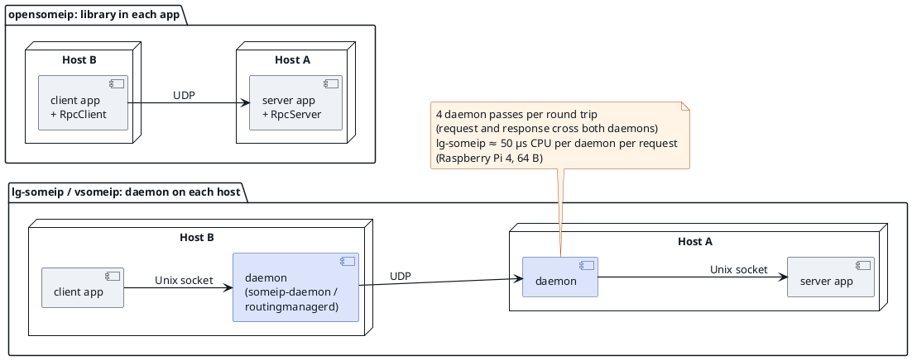
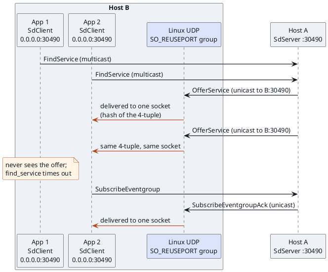
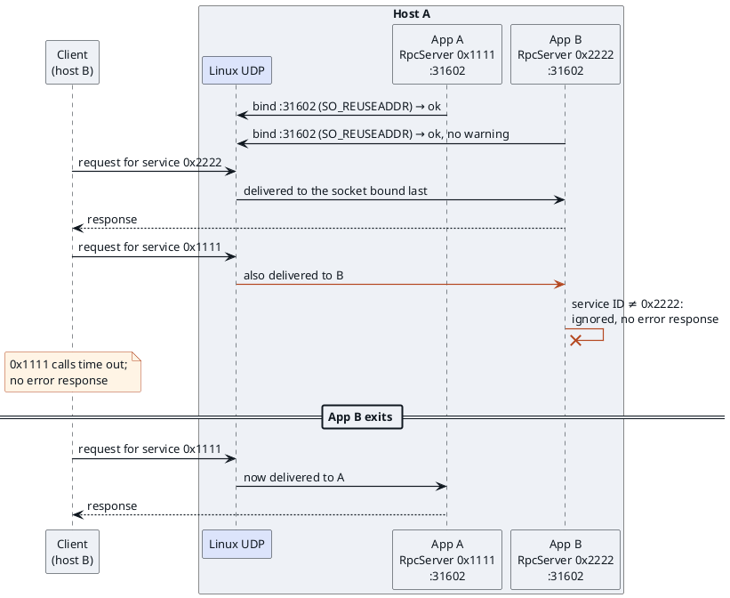
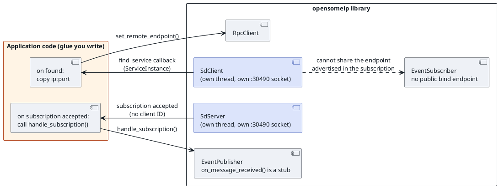
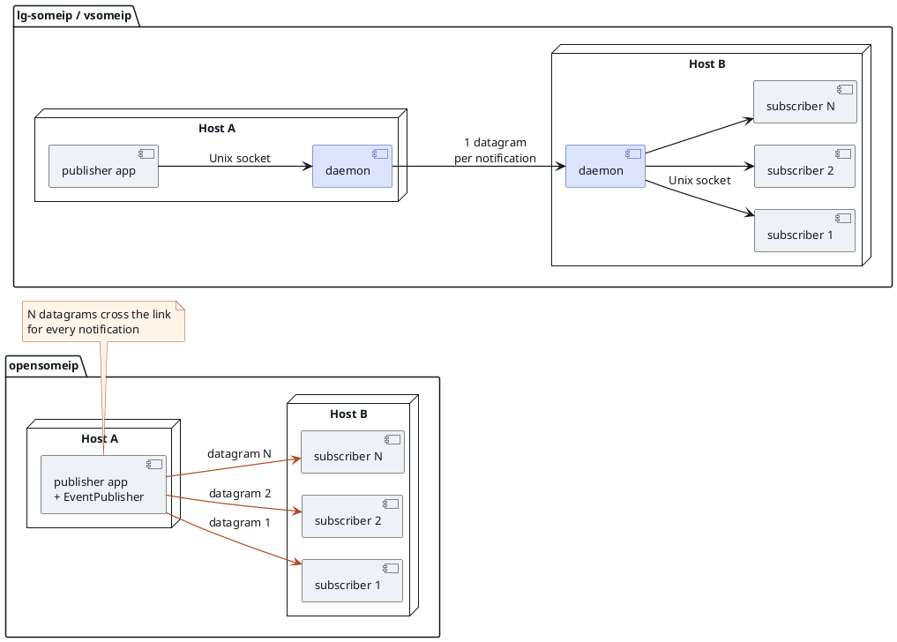

SOME/IP stack evaluation · October 2026

# opensomeip v0.2.0 Findings

opensomeip had the fastest data path for small messages of the three SOME/IP stacks we measured. It gets there by leaving the routing daemon out, and most of the problems below are jobs that daemon does: owning ports, coordinating Service Discovery for a host, and sending one copy of an event to each host.

opensomeip v0.2.0 compared with lg-someip c154a40 and vsomeip 3.7.6 2 × Raspberry Pi 4 Model B, kernel 6.12.75 1 Gb/s direct link, PTP-synchronized

opensomeip is proposed to the Eclipse Foundation as the Eclipse LIBERSOM project (Eclipse Automotive, in community review as of October 2026). The findings below refer to opensomeip v0.2.0.

## How each finding is backed

TestedMeasured on the two Raspberry Pi 4 boards.

CodeRead in the opensomeip v0.2.0 source; file and line given.

InferredFollows from the design; not measured.

## Where the speed comes from

A request in lg-someip or vsomeip crosses a daemon on each host, in both directions: four forwarding passes per round trip. In opensomeip the application owns its UDP socket, so a round trip crosses only two processes. On the Raspberry Pi 4 this makes opensomeip's round trip 123 µs shorter than lg-someip's at 64 B and 81 µs shorter at 1400 B.

| 64 B, two hosts, Raspberry Pi 4 | Round trip p50 | Processes on the path | CPU per request, all processes | Maximum throughput |
| --- | --- | --- | --- | --- |
| opensomeip | 149.9 µs | 2 | 81 µs | 63,816 msg/s |
| lg-someip | 272.9 µs | 4 | 226 µs | 29,910 msg/s |
| vsomeip | 304.6 µs | 4 | 329 µs | 14,360 msg/s |

CPU per request is the sum over all processes on both hosts, with 128 request threads at a fixed 6,400 requests/s.

**Figure 1.** What sits between the requester and the responder in each architecture.

The same accounting explains the rest of the comparison. Maximum RPC throughput at 64 B (63.8k, 29.9k and 14.4k msg/s) follows CPU per request. One-way event latency is lower by the two daemon passes (63 µs p50 against 132 µs for lg-someip and 156 µs for vsomeip, 64 B, one subscriber). The advantage is limited to small and medium messages: opensomeip splits a 1400 B message into two packets with SOME/IP-TP, and at 1400 B lg-someip is faster (26,168 against 20,484 msg/s at maximum rate, and 24,551 against 19,728 msg/s with 128 request threads). Everything that follows is the price of the missing daemon.

Problems 1–4

## Several applications on one host

Each opensomeip application opens its own sockets, including the SD socket on port 30490, and nothing coordinates them.

### 1. SD replies reach only one application

CodeInferred

Every `SdServer` and `SdClient` binds `0.0.0.0:30490` with `SO_REUSEPORT` (`sd_server.cpp:72`, `sd_client.cpp:67`). Linux delivers a unicast datagram to just one socket in such a group, picked by a hash of the source and destination addresses. Offers sent in reply to a FindService and eventgroup subscribe ACKs are unicast, all with the same addresses, so they all land in the same process. The other applications on the host do not learn that the service exists.

**Figure 2.** Two SD clients on one host share port 30490; every unicast reply reaches the same one.

### 2. Different services cannot share a port, and nothing reports it

CodeInferred

The specification requires port sharing between services. feat_req_someip_445: "different Services shall be able to share the same port number", while instances of the *same* service on one ECU need different ports (also feat_req_someip_967). feat_req_someip_732 goes further: an ECU de/multiplexes internally and carries all SOME/IP messages to another ECU on a single port pair.

In opensomeip every `RpcServer` owns its own transport (its only constructor takes one service ID and one endpoint), and every `UdpTransport` sets `SO_REUSEADDR` (`reuse_address{true}`, `udp_transport.cpp:335–342`). A second server on a port already in use therefore binds without error, and the socket bound last receives all unicast traffic for that port.

### 3. A shadowed service just times out

Code

`RpcServer` ignores a request whose service ID is not its own instead of answering with an error (`rpc_server.cpp:169`). Callers of the shadowed service see timeouts, not error responses, which makes the collision in problem 2 hard to diagnose.

**Figure 3.** Two services on one port, which the specification allows: the later bind takes all unicast traffic and requests for the other service vanish.

### 4. No host-wide coordination

Code

There is no shared view of the services on a host, no single subscription per host, and no way to serve one port from several processes. Each application runs its own SD threads (an offer timer, and a maintenance loop that wakes every 20 ms) and its own sockets. Because `RpcServer` cannot share a transport (problem 2), offering several services on one port, as feat_req_someip_445 and 732 expect, would mean writing your own demultiplexer on a raw `UdpTransport` instead of using `RpcServer`. That is inferred from the API; I did not test it.

Problems 5–8

## Service Discovery is separate from communication

SD is a pair of library classes that each application creates. The RPC and event classes never consult it.

### 5. The application has to connect SD to RPC and events

Code

Nothing in `src/rpc` or `src/events` refers to SD. The application takes the `ServiceInstance` that `SdClient::find_service()` reports and configures the endpoint itself, as the official `examples/basic/sd_demo` does.

### 6. Events need hand-written glue

Code

- `EventPublisher::on_message_received()` is an empty stub, so the application must call `handle_subscription()` itself.
- `EventSubscriber` exposes no bind endpoint, so a stock `SdClient` and a stock `EventSubscriber` cannot share the endpoint advertised in a subscription.
- The SD callback for an accepted subscription does not pass the subscriber's client ID, which `handle_subscription()` needs.

**Figure 4.** The pieces the application has to wire together, and the one it cannot.

### 7. Slow SD defaults

Code

`SdConfig` defaults to a cyclic offer every 30 s, an offer TTL of 1 hour, and a 2 s repetition base (`sd_types.h:98–102`). With these defaults a consumer would notice a crashed provider only when the TTL ran out, up to an hour later. For comparison, lg-someip uses a fixed TTL of 3 counted down every 1.1 s. A fair SD comparison needs matched settings.

### 8. `SdConfig::unicast_port` appears unused

Code

Both SD classes bind their single socket to `multicast_port` (`sd_server.cpp:72`, `sd_client.cpp:67`). I found no setting that would give each application its own unicast SD socket and avoid problem 1.

Problems 9–10

## The data path under load

Without a daemon, long-running clients and event fan-out depend on each application's own code, and every subscriber costs a copy on the network.

### 9. The RPC client hangs after 65,535 calls

Code

`RpcClient` creates a SOME/IP session for every call (`SessionManager::create_session`), and nothing removes it: the client calls neither `remove_session()` nor `cleanup_expired_sessions()`. After 65,535 calls on one `RpcClient` the session table holds every ID, and `SessionManager::get_next_session_id()` loops forever while it holds the table's mutex. Every thread that calls the client then hangs, one of them at 100% CPU (found with gdb during the first benchmark runs). At 1,000 calls/s this happens after about one minute.

Benchmark

The many-thread benchmark could only run because it replaces each opensomeip client every 50,000 calls. lg-someip and vsomeip needed no workaround.

Loss (tested)

On the Raspberry Pi 4, with this workaround, opensomeip lost up to 0.62% of its requests with 128 request threads (1400 B); lg-someip lost at most 0.15% in any step and vsomeip none.

### 10. Fan-out multiplies the traffic on the link

Tested

With one publisher and N subscribers on another host, an opensomeip publisher sends every notification once per subscriber, so the subscriber host receives N copies. In lg-someip and vsomeip the subscriber host's daemon subscribes once and delivers locally, so one copy crosses the link however many subscribers run there.

| Received by the subscriber host per notification | 1 subscriber | 2 | 4 | 8 |
| --- | --- | --- | --- | --- |
| opensomeip, 64 B payload | 108 B | 216 B | 432 B | 864 B |
| lg-someip, 64 B payload | 108 B | 108 B | 108 B | 108 B |
| vsomeip, 64 B payload | 108 B | 108 B | 108 B | 108 B |
| opensomeip, 1024 B payload | 1,066 B | 2,133 B | 4,266 B | 8,532 B |
| lg-someip, 1024 B payload | 1,066 B | 1,066 B | 1,066 B | 1,066 B |
| vsomeip, 1024 B payload | 1,066 B | 1,066 B | 1,066 B | 1,066 B |
| opensomeip, 1400 B payload | 1,494 B | 2,988 B | 5,975 B | 11,951 B |
| lg-someip, 1400 B payload | 1,442 B | 1,442 B | 1,442 B | 1,442 B |
| vsomeip, 1400 B payload | 1,442 B | 1,442 B | 1,442 B | 1,442 B |

Packets

opensomeip: 1, 2, 4 and 8 packets per notification at 64 and 1024 B, and twice as many at 1400 B, where SOME/IP-TP splits each message in two. lg-someip and vsomeip: 1 at every subscriber count and payload size.

At 1000/s

8 subscribers of a 1024 B event: about 68 Mbit/s into the subscriber host with opensomeip, about 8.5 Mbit/s with the daemon stacks.

Publisher

The opensomeip publisher also pays for the copies in its own thread: the notify-call p99 grew from 53 µs with 1 subscriber to 114 µs with 8 at 64 B, and from 68 µs to 205 µs at 1400 B. lg-someip stayed at 27–37 µs and vsomeip at 42–49 µs at every subscriber count.

**Figure 5.** One publisher, N subscribers on another host: one datagram per notification through the daemons, N datagrams with opensomeip.

## What this means for the evaluation

- The data-path result stands for small and medium messages: on the Raspberry Pi 4, opensomeip's round trip is 123 µs shorter than lg-someip's at 64 B and its maximum throughput is 2.1× higher. At 1400 B lg-someip is faster.
- Problems 1–4 and 10 are jobs a daemon does: owning the ports, coordinating SD for the host, and receiving one copy of an event for all local subscribers. Problems 5–7 are integration work left to each application. Problem 9 is a defect that stops any long-running RPC client.
- Problem 2 is also a conformance gap: the specification expects different services to share a port (feat_req_someip_445, 732), and opensomeip's RPC classes cannot.
- None of the benchmark numbers used opensomeip's SD. The harness used fixed endpoints, so problems 1, 7 and 8 do not affect them.
- Everything here refers to v0.2.0.

## Method and data

Two Raspberry Pi 4 Model B boards on a direct 1 Gb/s link, both on kernel 6.12.75 with `net.core.rmem_max` at 4 MB, the performance governor, and PTP running on both. Providers ran on host A (rasp1), consumers on host B (rasp2); apps were pinned to CPUs 2–3 and daemons to CPU 1. Latency and throughput figures are medians of 5 interleaved repetitions; the many-thread and event figures are medians of 3. Network traffic was counted with nftables counters on both boards (UDP between the two hosts; SD on port 30490 and PTP counted separately); bytes are IP packet lengths, so a 64 B payload is 108 B on the wire (20 B IP, 8 B UDP, 16 B SOME/IP header). Data: `performance-measurement/results/pi4-20261014-1454-standard`, `-threads`, and `-events`. Findings marked Code refer to the opensomeip v0.2.0 source; findings marked Inferred follow from that code and the documented Linux socket behaviour and were not re-measured on the Raspberry Pi 4. Requirement IDs refer to `src/someip-rpc.rst` of the [Open SOME/IP Specification](https://github.com/some-ip-com/open-someip-spec) at commit 94e4ea9; the same rule appears as TR_SOMEIP_00163 / PRS_SOMEIP_00163 in the AUTOSAR SOME/IP documents.