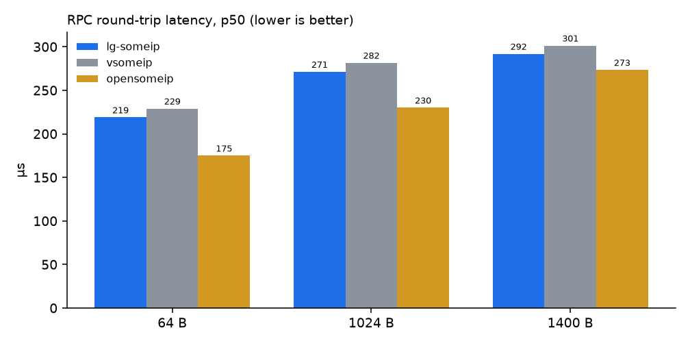
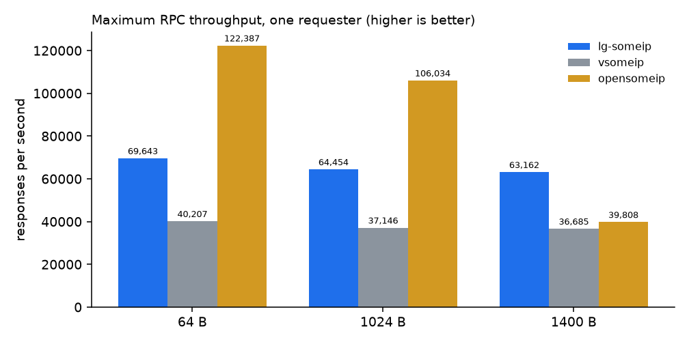
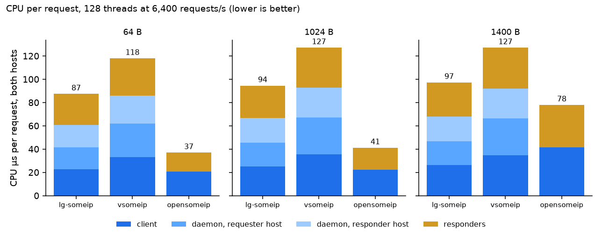
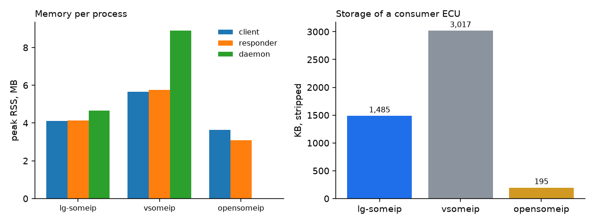
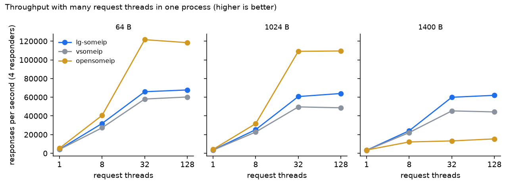

# lg-someip performance report — Raspberry Pi 5 Model B

_SOME/IP stack evaluation · generated by `performance-measurement/scripts/make-report.py` from measured data · lg-someip `c154a40-dirty`, vsomeip 3.7.6, opensomeip v0.2.0_

## 1. Summary

lg-someip is a **routing-daemon stack**, like vsomeip: applications talk to a per-host daemon that owns the ports, Service Discovery (SD), and the network. opensomeip has no daemon; each application owns its sockets. The two kinds of stack therefore answer different questions, and this report keeps them apart:

- **Against vsomeip, the like-for-like comparison, lg-someip is ahead on every axis we measured.** Round-trip latency is 3.1–4.4% lower at p50 and 3.2–4.7% lower at p99. Processing one request costs 24–26% less CPU in total (all processes on both hosts), and 25–31% less in the requesting process. Memory is 27% (client), 28% (responder), and 48% (daemon) lower, storage is 51% smaller, and the maximum throughput is 1.72–1.74× that of vsomeip (1.13–1.40× with 128 request threads).
- **Against opensomeip, lg-someip trades some raw speed for what a daemon provides.** opensomeip is faster on small messages because a round trip crosses two processes instead of four (p50 175 µs against 219 µs at 64 B). The gap shrinks to 19 µs at 1400 B, and there lg-someip is the faster stack under load: 4.0× the throughput of opensomeip with 128 request threads, and 1.6× at maximum rate.
- **lg-someip scales with the number of threads at a steady cost.** From 8 to 128 request threads its CPU per request grows by only 17–26%, its throughput rises 2.1–2.6×, and it loses at most 0.06% of requests in any step. It never hung.
- **The daemon is a feature, not only a cost.** It gives a host one SD endpoint for all its applications and one copy of an event on the link for any number of local subscribers: with 8 subscribers of a 1024 B event the subscriber host receives 1,066 B per notification with lg-someip and 8,532 B with opensomeip (8.0×). Section 8 has the detail.

### Scorecard

| Metric (lower is better unless it is throughput) | lg-someip | vsomeip | opensomeip |
|---|---|---|---|
| p50 latency, 64 B (µs) | 219 | 229 | **175** |
| p50 latency, 1400 B (µs) | 292 | 301 | **273** |
| Max throughput, 64 B (msg/s) | 69,643 | 40,207 | **122,387** |
| Max throughput, 1400 B (msg/s) | **63,162** | 36,685 | 39,808 |
| 128 threads, 1400 B (msg/s) | **62,031** | 44,281 | 15,424 |
| CPU per request, all processes, 128 threads at 6,400/s, 64 B (µs) | 88 | 119 | **37** |
| CPU per request, all processes, same load, 1400 B (µs) | 97 | 128 | **78** |
| Client memory, peak RSS (MB) | 4.1 | 5.7 | **3.6** |
| Storage, consumer ECU (KB) | 1,485 | 3,017 | **195** |

Bold marks the best value of a row. opensomeip often wins the rows it skips a daemon for; read it together with section 8.

## 2. What was measured, and how

- **Hardware.** Two Raspberry Pi 5 Model B Rev 1.0 boards on a 1 Gb/s Ethernet link, both on kernel 6.18.50+rpt-rpi-2712, `net.core.rmem_max` 4 MB, CPU governor `performance`, PTP running on both. The responders ran on host A and the requesters on host B. Application processes were pinned to CPUs 2–3 and the daemons to CPU 1.
- **Same measurement code in every stack.** One shared kit (`performance-measurement/lg-someip/common`) provides the payload layout, pacing, exact percentiles, and CPU accounting. The same service, method, instance, and payload sizes appear on the wire for every stack. Every response has the size of its request.
- **Repetitions.** The latency, throughput, and memory figures are medians of 5 repetitions that rotate the stack order, so no stack always runs first on cold hardware. The many-thread and event figures are medians of 3 repetitions. Ranges are in the generated tables of each run (`merged/comparison.md`).
- **Payloads.** 64, 1024, and 1400 B (1400 B is the largest payload that fits one UDP datagram without SOME/IP-TP).
- **Scenarios.** Closed-loop round trip (latency); fixed load of 1,000 requests/s (latency under load and client CPU); maximum rate with a 1,000-request window (throughput); and one process with 1, 8, 32, or 128 request threads calling 1 or 4 responders, both at maximum rate and at a fixed 50 requests/s per thread (CPU).
- **CPU** is the scheduler's own accounting. The requesting process reports its own CPU over the measured window. The daemons and responders are read from `/proc` around each many-thread step, minus their idle CPU, divided by the calls of the step. The scheduler counts in 10 ms ticks, so single figures at 8 threads carry a few microseconds of rounding; the 32- and 128-thread rows are accurate to a few percent.
- **opensomeip** has no daemon and no SD in this harness; the benchmark passes the provider address and port explicitly. Its numbers exclude daemon IPC and discovery by design.

## 3. Latency

Round trip of one request with one outstanding (closed loop), from just before the send call to the start of the response callback. Medians of the repetitions.

| Payload | lg-someip p50 / p99 (µs) | vsomeip p50 / p99 (µs) | opensomeip p50 / p99 (µs) | lg-someip lower than vsomeip (p50) | lg-someip minus opensomeip (p50) |
|---|---|---|---|---|---|
| 64 B | 218.9 / 230.1 | 229.0 / 241.4 | **174.9 / 180.9** | 4.4% | +44 µs |
| 1024 B | 271.2 / 283.1 | 281.6 / 294.1 | **230.1 / 240.7** | 3.7% | +41 µs |
| 1400 B | 291.9 / 303.9 | 301.3 / 313.9 | **273.4 / 284.3** | 3.1% | +19 µs |



- lg-someip's round trip is 3.1–4.4% shorter than vsomeip's at p50 and 3.2–4.7% shorter at p99. Both use the same four-hop path (application → daemon → network → daemon → application), so the difference is the cost of each hop. lg-someip's p99 is within 12 µs of its p50 at every size: the path has no heavy tail.
- opensomeip skips the daemon hops and is faster at small sizes. Its round trip grows by 98 µs from 64 to 1400 B, lg-someip's by 73 µs, so opensomeip's lead shrinks from 44 µs at 64 B to 19 µs at 1400 B.
- Lost requests in the closed-loop runs: 0.

At a fixed load of 1,000 requests/s the picture is the same:

| Payload | lg-someip p50 / p99 (µs) | vsomeip p50 / p99 (µs) | opensomeip p50 / p99 (µs) |
|---|---|---|---|
| 64 B | 221.1 / 238.6 | 232.5 / 250.5 | 181.1 / 191.5 |
| 1024 B | 273.2 / 290.5 | 285.8 / 304.9 | 231.5 / 246.7 |
| 1400 B | 294.1 / 311.2 | 305.5 / 323.0 | 274.7 / 290.0 |

## 4. Throughput

One requester sends as fast as it can with at most 1,000 requests in flight (maximum rate, open loop).

| Payload | lg-someip (msg/s) | vsomeip (msg/s) | opensomeip (msg/s) | lg-someip ÷ vsomeip |
|---|---|---|---|---|
| 64 B | 69,643 (2.48% lost) | 40,207 (0.00% lost) | **122,387 (1.47% lost)** | 1.73× |
| 1024 B | 64,454 (2.68% lost) | 37,146 (0.00% lost) | **106,034 (2.55% lost)** | 1.74× |
| 1400 B | **63,162 (2.67% lost)** | 36,685 (0.00% lost) | 39,808 (0.00% lost) | 1.72× |



- lg-someip delivers 1.72–1.74× the throughput of vsomeip at every size.
- Loss at the maximum rate depends on back-pressure. vsomeip's client blocks when its queue is full, so it loses nothing but is slower. lg-someip (2.5–2.7%) and opensomeip (0.0–2.5%) drop a small share of requests when they are offered more than the path carries; this is an overload test, not a latency comparison. Where the application waits for each response (section 7), lg-someip loses at most 0.06%.
- opensomeip leads at 64 and 1024 B, where the missing daemon matters most. At 1400 B its throughput falls to 39,808 msg/s while lg-someip holds 63,162.

**On the wire.** Packets and bytes on the link per request and response (both directions, IP packet lengths, counted with nftables at 1,000 requests/s):

| Payload | lg-someip | vsomeip | opensomeip |
|---|---|---|---|
| 64 B | 2.00 pkt · 216 B | 2.00 pkt · 216 B | 1.94 pkt · 210 B |
| 1024 B | 2.00 pkt · 2,136 B | 2.00 pkt · 2,136 B | 2.00 pkt · 2,136 B |
| 1400 B | 2.00 pkt · 2,888 B | 2.00 pkt · 2,888 B | 4.00 pkt · 2,992 B |

At 1400 B opensomeip sends every message as two packets (the harness documents that its RPC classes split large messages with SOME/IP-TP): 4 packets per request against 2 for lg-someip and vsomeip, which carry 1400 B in one datagram. This is consistent with the jump in opensomeip's CPU per request and the drop in its throughput at that size, which we did not isolate further.

## 5. CPU

CPU time per request is the cost that matters on a small ECU: it decides how many requests a core can serve. The table adds up **all processes on both hosts** (the requester, the daemon on each host, and the responders) for one process with 128 request threads calling 4 responders at a fixed 6,400 requests/s, the same offered work for every stack.

| Payload | Stack | Requester µs | Daemon (requester host) µs | Daemon (responder host) µs | Responders µs | **Total µs / request** | Requester CPU (% of one core) |
|---|---|---|---|---|---|---|---|
| 64 B | lg-someip | 22.8 | 18.8 | 19.2 | 26.6 | 87.6 | 14.6 |
| 64 B | vsomeip | 33.1 | 28.9 | 23.8 | 32.0 | 118.9 | 21.2 |
| 64 B | opensomeip | 20.5 | 0.0 | 0.0 | 16.4 | 36.6 | 13.1 |
| 1024 B | lg-someip | 24.9 | 20.7 | 21.1 | 27.7 | 94.4 | 15.9 |
| 1024 B | vsomeip | 35.3 | 31.6 | 25.8 | 34.4 | 126.9 | 22.6 |
| 1024 B | opensomeip | 22.3 | 0.0 | 0.0 | 18.7 | 41.1 | 14.3 |
| 1400 B | lg-someip | 26.1 | 20.7 | 21.1 | 29.3 | 97.2 | 16.7 |
| 1400 B | vsomeip | 34.8 | 31.3 | 25.8 | 35.2 | 128.2 | 22.3 |
| 1400 B | opensomeip | 41.6 | 0.0 | 0.0 | 36.3 | 77.5 | 26.6 |



- **vs vsomeip:** lg-someip needs 24–26% less CPU per request in total, and each part is cheaper: the requester (25–31% less), both daemons, and the responders. The daemon on the requester host costs lg-someip 21 µs per request at 1024 B against 32 µs for vsomeip's routing manager.
- **vs opensomeip:** the daemons are the price of the architecture: 38 µs per request at 64 B, about 2.4× opensomeip's total. At 1400 B the gap narrows to 1.3×, because opensomeip's own CPU per request rises (41 µs at 1024 B to 78 µs at 1400 B) while lg-someip's barely does (94 to 97 µs).
- **Single requester at 1,000 requests/s** (requesting process only, pacing excluded): lg-someip 15.1 µs, vsomeip 22.3 µs, opensomeip 12.5 µs per request at 64 B.

## 6. Memory and storage

**RAM**, peak resident set size (MB):

| Stack | Requester (1 thread) | Requester (128 threads) | Responder | Daemon |
|---|---|---|---|---|
| lg-someip | 4.1 | 9.6 | 4.1 | 4.7 |
| vsomeip | 5.7 | 16.7 | 5.8 | 8.9 |
| opensomeip | 3.6 | 10.6 | 3.1 | no daemon |

**ROM**, stripped files of one consumer ECU (the daemon, the stack library, and the benchmark's client application; third-party shared libraries would count, the C++ runtime and libc do not):

| Stack | Files | Total |
|---|---|---|
| lg-someip | someip-daemon 516 KB, liblgsomeip.so 838 KB, perf-rpc-client 131 KB | 1,485 KB |
| vsomeip | routingmanagerd 66 KB, libvsomeip3.so.3.7.6 2,820 KB, perf-rpc-client 131 KB | 3,017 KB |
| opensomeip | perf-rpc-client 195 KB | 195 KB |



- lg-someip's memory is 27% (requester), 28% (responder), and 48% (daemon) below vsomeip's. A consumer ECU that runs a daemon and two applications saves about 7 MB.
- lg-someip needs 51% less storage than vsomeip, 1,532 KB less: vsomeip's library alone is 2,820 KB. opensomeip is the smallest (195 KB, 7.6× smaller than lg-someip) because the library is linked into the application and there is no daemon. The daemon and the library are shared by every application on an ECU, so lg-someip's fixed cost is paid once while each opensomeip application carries its own copy of the stack.

## 7. Many request threads in one process

A service with many request threads is the hard case for a SOME/IP library: every thread calls into the same stack at once. One process runs 1, 8, 32, or 128 worker threads; each sends a request, waits for the response, and repeats, calling 1 or 4 responders in turn. The response has the size of the request. All of it shares the board's two application CPUs.

**Maximum rate** (each thread sends again as soon as its response arrives), 4 responders:

| Payload | Threads | lg-someip | vsomeip | opensomeip |
|---|---|---|---|---|
| 64 B | 1 | 4,258 · p99 246 µs · 0.00% lost | 4,071 · p99 257 µs · 0.00% lost | **5,416 · p99 194 µs · 0.00% lost** |
| 64 B | 8 | 31,936 · p99 316 µs · 0.00% lost | 27,308 · p99 342 µs · 0.00% lost | **40,602 · p99 242 µs · 0.00% lost** |
| 64 B | 32 | 65,889 · p99 582 µs · 0.00% lost | 58,064 · p99 656 µs · 0.00% lost | **121,591 · p99 563 µs · 0.00% lost** |
| 64 B | 128 | 67,785 · p99 2,070 µs · 0.00% lost | 60,249 · p99 2,235 µs · 0.00% lost | **118,409 · p99 1,461 µs · 0.06% lost** |
| 1024 B | 1 | 3,464 · p99 300 µs · 0.00% lost | 3,341 · p99 312 µs · 0.00% lost | **4,151 · p99 252 µs · 0.00% lost** |
| 1024 B | 8 | 25,272 · p99 388 µs · 0.00% lost | 22,725 · p99 412 µs · 0.00% lost | **31,689 · p99 298 µs · 0.00% lost** |
| 1024 B | 32 | 60,714 · p99 663 µs · 0.00% lost | 49,631 · p99 757 µs · 0.00% lost | **109,121 · p99 472 µs · 0.00% lost** |
| 1024 B | 128 | 63,992 · p99 2,323 µs · 0.00% lost | 48,702 · p99 2,774 µs · 0.00% lost | **109,491 · p99 1,977 µs · 0.06% lost** |
| 1400 B | 1 | 3,236 · p99 321 µs · 0.00% lost | 3,128 · p99 332 µs · 0.00% lost | **3,491 · p99 299 µs · 0.00% lost** |
| 1400 B | 8 | **24,123 · p99 401 µs · 0.00% lost** | 22,167 · p99 431 µs · 0.00% lost | 12,151 · p99 351 µs · 0.04% lost |
| 1400 B | 32 | **59,954 · p99 681 µs · 0.00% lost** | 45,371 · p99 821 µs · 0.00% lost | 13,231 · p99 369 µs · 0.22% lost |
| 1400 B | 128 | **62,031 · p99 2,804 µs · 0.00% lost** | 44,281 · p99 3,031 µs · 0.00% lost | 15,424 · p99 1,297 µs · 0.80% lost |



- **lg-someip scales at a steady cost.** From 8 to 128 threads its requester CPU per request grows by 17–26% while its throughput rises 2.1–2.6×. Latency percentiles rise with the thread count in every stack: the threads queue for two CPUs. lg-someip loses at most 0.06% of requests in any step.
- **vs vsomeip**, the same design, lg-someip delivers 1.13–1.40× the throughput at 128 threads (4 responders) and a lower p99 in 24 of 24 maximum-rate steps.
- **vs opensomeip**, lg-someip is 0.57× at 64 B, 0.58× at 1024 B, and 4.0× at 1400 B with 128 threads: opensomeip leads on small messages. At 1400 B it loses up to 0.80% of its requests, and a lost request holds its thread until the 1 s timeout, so a few losses per second idle several threads and closed-loop throughput falls. In the same step lg-someip loses 0.00%.
- **opensomeip needed a workaround to run at all.** Its `RpcClient` never releases sessions; after 65,535 calls on one client the next call spins forever holding a lock, and every thread hangs. The benchmark replaces each opensomeip client every 50,000 calls to avoid it. lg-someip and vsomeip needed no such measure. See the opensomeip notes in `performance-measurement/docs/stack-comparison.md`.

**Fixed load** (50 requests/s per thread, 6,400/s with 128 threads): every stack carries the same offered work, which makes this the fair basis for the CPU comparison of section 5. Latency stays close to the idle round trip of section 3, with the rare outliers noted below.

| Payload (128 threads, 4 responders) | lg-someip p50 / p99 (µs) | vsomeip p50 / p99 (µs) | opensomeip p50 / p99 (µs) |
|---|---|---|---|
| 64 B | 227 / 251 | 241 / 269 | 185 / 196 |
| 1024 B | 284 / 304 | 298 / 324 | 240 / 250 |
| 1400 B | 306 / 331 | 322 / 344 | 280 / 295 |

## 8. Why lg-someip: advantages and merits

### 8.1 Against vsomeip

vsomeip is the established open-source stack and has the same architecture, so this is the comparison that isolates implementation quality. lg-someip wins it everywhere:

| Axis | lg-someip against vsomeip | Where |
|---|---|---|
| Round-trip latency (p50) | 3.1–4.4% lower | section 3 |
| Round-trip latency (p99) | 3.2–4.7% lower | section 3 |
| Maximum throughput | 1.72–1.74× | section 4 |
| Throughput, 128 threads | 1.13–1.40× | section 7 |
| CPU per request, all processes | 24–26% lower | section 5 |
| CPU per request, requesting process | 25–31% lower | section 5 |
| RAM: requester / responder / daemon | 27% / 28% / 48% lower | section 6 |
| Storage (consumer ECU) | 51% smaller | section 6 |

What this means in practice:

- **More headroom on the same silicon.** Fewer CPU microseconds per request means the same ECU serves more requests, or the same load leaves more of the core to the application. The saving is in every process on the path, so it does not depend on where the work runs.
- **A smaller footprint on a constrained ECU.** 51% less flash, 27–28% less RAM in applications and 48% less in the daemon than vsomeip.
- **Steadier behaviour under many threads.** lg-someip's cost per request grows slowly with the thread count, and its throughput stays ahead of vsomeip's at every thread count.

### 8.2 Against opensomeip

opensomeip's data path is the fastest we measured because it leaves the daemon out. That is a design trade, not a free win: the jobs the daemon does for a whole host fall to every application instead.

**Event fan-out, measured.** One publisher on host A, 1 to 8 subscribers on host B, 1,000 notifications/s. The table counts what reaches host B per published notification (IP packet bytes and packets, from nftables counters on the link; a few lost notifications lower a value slightly).

| Payload | Subscribers on host B | lg-someip | vsomeip | opensomeip |
|---|---|---|---|---|
| 64 B | 1 | 108 B · 1.00 pkt | 108 B · 1.00 pkt | 108 B · 1.00 pkt |
| 64 B | 2 | 106 B · 0.98 pkt | 108 B · 1.00 pkt | 216 B · 2.00 pkt |
| 64 B | 4 | 108 B · 1.00 pkt | 108 B · 1.00 pkt | 432 B · 4.00 pkt |
| 64 B | 8 | 105 B · 0.97 pkt | 108 B · 1.00 pkt | 863 B · 8.00 pkt |
| 1024 B | 1 | 1,066 B · 1.00 pkt | 1,066 B · 1.00 pkt | 1,066 B · 1.00 pkt |
| 1024 B | 2 | 1,066 B · 1.00 pkt | 1,066 B · 1.00 pkt | 2,133 B · 2.00 pkt |
| 1024 B | 4 | 1,066 B · 1.00 pkt | 1,066 B · 1.00 pkt | 4,266 B · 4.00 pkt |
| 1024 B | 8 | 1,066 B · 1.00 pkt | 1,046 B · 0.98 pkt | 8,532 B · 8.00 pkt |
| 1400 B | 1 | 1,386 B · 0.96 pkt | 1,425 B · 0.99 pkt | 1,494 B · 2.00 pkt |
| 1400 B | 2 | 1,442 B · 1.00 pkt | 1,442 B · 1.00 pkt | 2,988 B · 4.00 pkt |
| 1400 B | 4 | 1,442 B · 1.00 pkt | 1,442 B · 1.00 pkt | 5,975 B · 7.99 pkt |
| 1400 B | 8 | 1,442 B · 1.00 pkt | 1,442 B · 1.00 pkt | 11,950 B · 15.98 pkt |

In lg-someip, host B's daemon subscribes once and delivers locally, so one copy crosses the link however many subscribers run there: 1,066 B per notification with 8 subscribers of a 1024 B event, about 8.5 Mbit/s at 1,000/s. opensomeip's publisher sends one copy per subscriber: 8,532 B, about 68 Mbit/s (8.0× the traffic). The saving grows with every subscriber and with the payload size, on a link that is shared with all other traffic.

The existing findings document (`opensomeip-v0.2.0-findings.md`) tested more of what the missing daemon costs. Those results are quoted from that document and were **not re-measured** here:

| Topic | opensomeip v0.2.0 (findings document) | lg-someip |
|---|---|---|
| Several applications on one host | SD replies reach only one of two applications (1 of 2 in every trial); different services cannot share a port | One daemon owns the ports and SD for the whole host |
| Event and SD glue | The application connects SD to RPC and events itself; SD defaults are slow | SD, RPC, and events go through the daemon and are configured from one file |

And in this report's own measurements:

- **At 1400 B lg-someip is the faster stack under load** (4.0× opensomeip's throughput at 128 threads). From 1024 to 1400 B its CPU per request rises 3%, opensomeip's 89%. lg-someip carries a 1400 B payload in one UDP datagram; opensomeip sends two packets per message (section 4).
- **lg-someip is the more predictable one.** It lost at most 0.06% in any many-thread step. opensomeip needed a client-replacement workaround to avoid a hang and lost up to 0.80%.
- **The cost is bounded.** The extra round-trip time is 44 µs at 64 B and 19 µs at 1400 B, and the shared daemon is paid once per ECU rather than once per application.

### 8.3 When each stack fits

| Situation | Choose |
|---|---|
| One application per ECU, small messages, lowest possible latency, SD handled elsewhere | opensomeip |
| Several applications per ECU, SD and events needed, configuration-driven deployment | lg-someip |
| Same architecture as vsomeip with less CPU, memory, and storage | lg-someip |
| Many request threads or messages near 1400 B under load | lg-someip |

## 9. Limits of this report

- Two boards on one Ethernet link: the absolute numbers belong to this hardware. The ranking and the percentages are the transferable result.
- **Service Discovery timing was not measured** in this round, and events were measured for traffic on the link only (section 8.2), not for latency. Everything else is RPC over UDP.
- The three stacks use different thread-pool defaults; their configuration formats do not expose equivalent knobs, so none was tuned.
- CPU of the daemons and responders comes from 10 ms scheduler ticks; the 32- and 128-thread rows are reliable to a few percent, the 8-thread rows less so.
- 128 threads on two cores partly measure scheduling behaviour, the same for every stack.
- opensomeip numbers use direct endpoints and no SD. A run with SD would add cost; the numbers here are its best case.
- The maximum-rate loss figures depend on each stack's back-pressure design and are not a latency comparison. In that open-loop test lg-someip drops about as many requests as opensomeip; only vsomeip, whose client blocks, loses none.

## 10. Reproduce

```bash
# standard run: latency, throughput, memory (about 30 minutes)
performance-measurement/scripts/run-comparison.sh -A <ssh A> -B <ssh B> -a <ip A> -b <ip B> -y -R 5 \
    -s "pingpong rate" -p "64 1024 1400" -r "1000 0" -N 6000 -D 3
# many threads: CPU and throughput (about 75 minutes)
performance-measurement/scripts/run-comparison.sh -A <ssh A> -B <ssh B> -a <ip A> -b <ip B> -m peers -s threads -R 3 \
    -p "64 1024 1400" -D 3 -O '-T "1 8 32 128" -M "1 4"'
# storage, event fan-out on the link, then this report
performance-measurement/scripts/run-comparison.sh -A <ssh A> -B <ssh B> -a <ip A> -b <ip B> -m peers -s event -R 3 \
    -p "64 1024 1400" -D 3 -O '-P 1 -U "1 2 4 8" -w'
performance-measurement/scripts/run-comparison.sh -A <ssh A> -B <ssh B> -a <ip A> -b <ip B> -m peers -s rpc -R 1 \
    -p "64 1024 1400" -D 3 -O '-R 1 -M 1 -m rate -w'    # packets per request on the link
performance-measurement/scripts/rom-footprint.sh ... > rom-footprint.txt
performance-measurement/scripts/make-report.py --standard <dir> --threads <dir> --events <dir> --rpcnet <dir> \
    --rom rom-footprint.txt --out <dir>
```

Data: `performance-measurement/results/final-20261014-0956-standard`, `performance-measurement/results/final-20261014-0956-threads`, `performance-measurement/results/final-20261014-0956-events`, `performance-measurement/results/final-20261014-0956-rpcnet` (`merged/comparison.md`, `merged/*.csv`; ROM in `rom-footprint.txt`).
